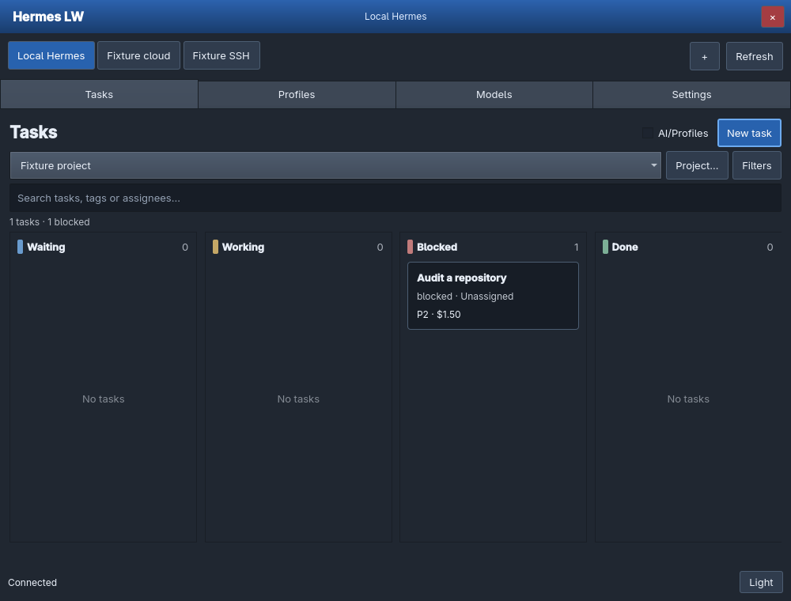
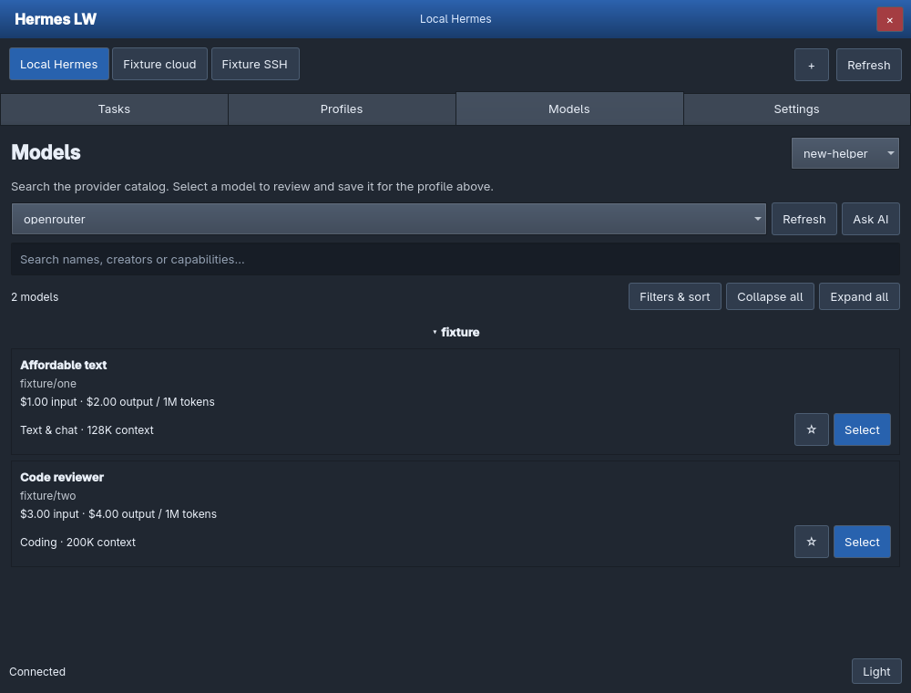

# Hermes LW

A small native Quickshell app for Hermes Agent on Hyprland. Four pages: **Tasks, Profiles, Models, Settings**. The interface has been rebuilt with standard keyboard-accessible Qt controls, adaptive layouts, scrollable forms and persistent errors.



## Run

Install Hermes Agent, Quickshell and Python with PyYAML. Confirm `hermes` and `qs` are on your PATH, then:

```sh
git clone https://github.com/thediamondsaint/hermes-lw.git
cd hermes-lw
./launch.sh
```

The launcher starts or reuses the version-matched local backend. The window tiles normally; it does not install floating or workspace rules. After updating, close and reopen the app to load the new UI. Profile files, task databases and credentials remain in their existing Hermes locations.

## Profiles

Open **Profiles → New profile**, enter a name and role, and choose its model. Names such as “Code reviewer” become the ID `code-reviewer`.

New profiles **fully clone `default`, including its provider keys**, unless you choose otherwise. **Copy settings, provider & API key** exposes the source, blank/settings/full-copy choice, key-copy checkbox, exact model ID and optional replacement key. Copied keys share the original provider account and spending limit.

Write the personality yourself, keep the source personality by leaving it empty, or click **Generate draft (paid)**. The form shows the exact provider/model and credential source. A separate draft-writing model is optional. Opening or saving a form never triggers generation. Failed generation preserves your text and shows the full error inside the form. OpenRouter direct-key budgets are checked before inference when the key can be identified; separate credential pools remain under Hermes’ resolver. An exhausted provider budget needs an adjusted provider-side limit or a different key.

Each profile has **Edit**, **Clone**, and **More…**. More contains pause/resume, manager selection, tools/apps and deletion. Pause prevents new assignments through this app; it does not cancel running workers.

## Models

Use **Models**, or **Choose model…** inside a profile/provider form. The same catalog supports multi-word search, favorites, creator/use/cost grouping, independent input/output price ceilings, sorting by name/cost/context, and collapse/expand all groups. **Filters & sort** keeps advanced controls out of the main view.

Catalogs follow the selected provider and credential profile. OpenRouter supplies published prices; other provider catalogs may lack pricing and are labeled accordingly. Filters are local and make no model requests. Selecting a profile model returns it to the form; saving applies it. Selecting from the main Models page requires a confirmation before changing an existing profile.

**Ask AI** recommends models from up to 30 filtered candidates. Choose its priced text model and submit explicitly; normal provider charges apply. It does not silently pick a paid recommendation model.



## Tasks and projects

Choose a project above the board. **Project…** creates, edits, exports or archives projects. The board has four readable groups—Waiting, Working, Blocked and Done—with the exact Hermes status on each card. Narrow windows scroll the board horizontally.

**New task** opens a single form for the title, instructions, allowed profiles, each profile’s positive USD planning budget, optional assignee, maximum runtime, priority, workspace, due date and tags. **No profiles are selected automatically.** Unassigned tasks start blocked. Assigned tasks may become runnable in Hermes. Runtime is bounded and retries are limited by the existing backend policy.

The **AI/Profiles** checkbox shows local profile suggestions based on task words; it makes no inference call and never checks a profile for you. Saved templates and task views are available without adding more top-level pages.

Open a card for status actions, assignment, priority, eligibility/budgets, cost/effort/date/tag notes, comments and dependency links. Title and body are shown as task context; they are not presented as editable when the installed CLI cannot update them.

**Dollar budgets are planning metadata, not hard spend caps.** Set provider-side API-key limits for spending control. Hermes clients outside this app can bypass its profile allowlist. Pausing or blocking does not guarantee cancellation of running workers.

## Settings, providers and connections

**Settings → Providers** opens a dedicated provider form for the chosen profile: backend, model catalog/manual ID, custom endpoint, reasoning and private API credentials. Clearing a key requires confirmation. OAuth/system-auth providers use Hermes’ own sign-in flow.

**Settings → Connections** adds local/SSH/VPS/HTTPS Hermes instances as separate connection tabs. SSH uses your OpenSSH configuration and keys; run the same Hermes LW backend on the remote host. HTTPS gateways require TLS and a separate Hermes LW gateway token. Gateway tokens stay in the local backend’s private connection file. Each connection remembers its page, project and selected profile while the app runs. Switching is blocked while requests are outstanding.

**Settings → Prompts** stores reusable/favorite prompts with edit, copy, delete and explicit local-terminal launch. **Profiles → More → Tools & apps** manages toolsets, disabled-first plugin installation, plugin enable/update/removal and MCP apps. Install and connect only trusted code/services.

The [project guide](https://thediamondsaint.github.io/hermes-lw/) includes current screenshots and remote setup instructions. [REBUILD.md](REBUILD.md) explains the new structure and remaining limits; earlier audit reports are historical.

## Development and verification

`Main.qml` is the window shell. `AppState.qml` owns HTTP requests, busy state, connection routing and shared data. Components in `ui/` own individual pages and forms. `HttpClient.qml` provides bounded, single-settlement requests. `backend.py` retains the validated Hermes management API.

```sh
python -m pip install -r requirements-test.txt
python -m unittest discover -s tests -v
python tests/cli_generation_smoke.py
python tests/ui_smoke.py
```

The CLI smoke test uses the actual installed Hermes CLI against a disposable local streaming provider with fake credentials. The UI suite first verifies a tiled fixture on desktop 4, then clicks native controls on an isolated Xvfb display so Qt actually renders their layouts. It needs Quickshell, QtTest, Xvfb and `xvfb-run`. `--capture` also writes synthetic screenshots to `/tmp/hermes-rebuilt-*.png` and needs ImageMagick. No test uses real provider keys or sends paid model requests.

The production backend listens on `127.0.0.1:18731`. Startup diagnostics: `~/.cache/hermes-control/backend.log`. Keys and connection credentials are stored in owner-only local files, never in the repository or returned as secret values to the UI.
