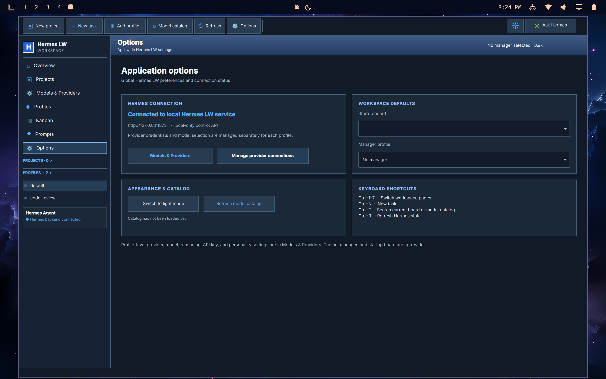
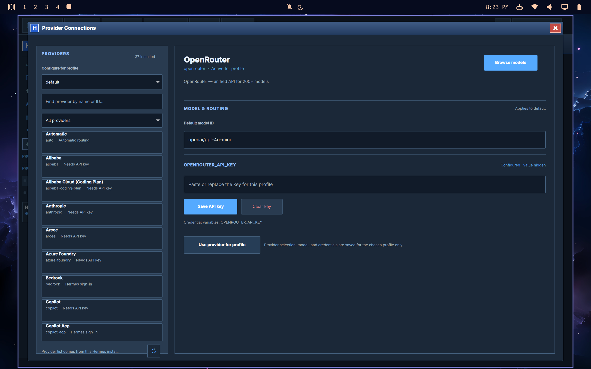
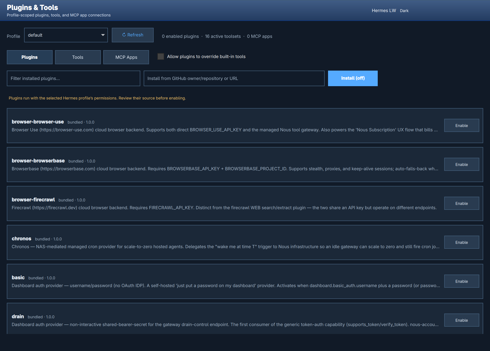

# Hermes LW

A native Quickshell app for controlling Hermes Agent profiles and Kanban boards across local, SSH-connected, and HTTPS-hosted Hermes LW instances.

## Run

```bash
cd ~/Projects/hermes-control
./launch.sh
```

The prototype reads the installed Hermes profile files and current board through the `hermes` CLI. The **Options** toolbar button and sidebar page open app-wide settings for the local Hermes LW connection, startup board, manager profile, theme, catalog refresh, and keyboard shortcuts. **Models & Providers** is a separate profile editor for backend, model, reasoning, and credentials. It supports full `SOUL.md` editing, an advanced JSON view of profile config, profile create/delete, config and full-state cloning, per-profile credentials for every inference provider registered by the installed Hermes version, pause/resume for new assignments, and structured personality generation using a selected generator profile. Generation uses the explicitly selected provider and model with credentials from the chosen profile, bypasses the source profile’s fallback chain and tools, and validates the output before showing it for review. Actual provider usage and retries still determine its cost. API-key credentials are written to that profile's `.env` with owner-only permissions. Custom/local OpenAI-compatible endpoints have a per-profile base URL and key saved in the profile config with owner-only permissions. OAuth and system-auth providers use Hermes' own sign-in flow (`hermes model`). Secrets never return to the UI. The OpenRouter catalog has multi-term search, creator and use filters, modality/capability/price/context filters, grouping by use, creator, price, context, or modality, and sorting by popularity order, name, release date, price, or context. Its catalog controls are laid out in separate rows for smaller windows: **Collapse all groups**, **Expand all groups**, sample input/output token fields, per-model sample cost, and **Show next 100 models**. Other providers accept their provider-specific model ID. Catalog data refreshes from OpenRouter and is cached for six hours. A local prompt library supports reusable and favorite prompts.

**Provider Connections** opens a dedicated window from Options. Choose a Hermes profile, search and filter the providers installed with Hermes, inspect each provider's setup status and credential variables, set its model ID or a custom/local endpoint URL, and save or clear that profile's API key without displaying its value. OpenRouter model choices flow from the catalog into this window.

The model catalog follows the provider selected for the active profile. OpenRouter uses its full priced catalog; other providers use model IDs discovered through Hermes' installed provider registry and profile credentials. Since Hermes does not return consistent pricing metadata for those catalogs, their prices are labeled unavailable. Input and output token prices can be filtered independently. Profile personality generation lets you select the credential profile, provider, and exact model ID from that provider's catalog before starting a generation; published token rates are shown when available. New profiles default to cloning the default profile's config, personality, and skills, without copying its API key. Tall profile, project, task, and catalog forms stay inside their window and scroll when they exceed the available screen height. **Task Advisor** suggests catalog models by task type, sample-token cost, and context length, and drafts prompts for code audits, implementation, research, writing, and general work. It does not send task text to a model. **Plugins & Tools** manages profile-scoped Hermes plugins, platform-specific toolsets, and MCP app connections. Plugin installs start disabled, enabling tool overrides requires an explicit opt-in, and plugin source trust is called out in the UI. MCP apps can be added as local stdio processes or remote HTTP services, installed from Hermes' catalog, tested, and removed. Remote bearer tokens are stored in the selected profile's private `.env`; local stdio environment values follow Hermes' profile config format. The API only returns credential variable names, never their values or raw MCP command arguments. These controls use Hermes' own config and plugin validation helpers.

In the model catalog, **Ask AI** takes a task description and ranks up to 30 models matching the active search and filters. Select an advisor model and credential profile first. It starts text generation only after you press the button; its displayed price is an estimate, not a provider spend cap.

Projects map to Hermes' isolated Kanban boards. The Projects page supports multiple boards, editable descriptions, owners, colors, budgets, deadlines, progress rollups, cost/effort totals, and JSON export to `~/Downloads`.

Ten workflow additions:

1. Set project budgets and see estimated spend and remaining budget.
2. Give each project an owner.
3. Set project delivery dates.
4. Track completion progress from Hermes task counts.
5. Add task tags and search by tag.
6. Set task due dates and see overdue dates highlighted.
7. Track planned effort hours beside cost estimates.
8. Start from built-in task templates or save custom templates.
9. Save board views with status, assignee, and search filters.
10. Select multiple tasks for bulk assignment, completion, or archiving.

The **AI/Profiles** checkbox locally matches task words to profile names, models, and personalities; suggestions never select a profile. This matching is heuristic and makes no model request. Each task has a fail-closed profile allowlist in Hermes LW: profiles are not selected by default, and the backend rejects task creation or assignment when a profile is outside the saved list. Tasks imported from Hermes without an Hermes LW allowlist are treated as eligible for nobody until an allowlist is saved. A separate positive USD planning budget is required for every allowed profile and is saved with the task. New tasks also require a Hermes-enforced maximum runtime; Hermes LW sets one attempt, so timeouts block instead of automatically retrying. **Runtime and profile allowlists limit work through this app; dollar values remain metadata. Hermes CLI/gateway clients can bypass Hermes LW's allowlist, and Hermes does not currently enforce a per-task dollar cap. Do not treat these values as a spend guarantee.** The board also supports scheduled work, task comments, dependency links, and per-project JSON exports while applying task lifecycle changes through Hermes' own CLI. Hermes owns the task body and comment history. The first config save makes a one-time `config.yaml.hermes-control-backup` next to the Hermes config. Pausing a profile in Hermes LW prevents new assignments from this app; already-running tasks continue. The UI uses Windows XP Luna styling with a persistent dark mode.

The [project guide](https://thediamondsaint.github.io/hermes-lw/) includes a step-by-step setup walkthrough, screenshots, and the current cost-enforcement research. Screenshots and a full Markdown copy are also in `docs/`.

The local control API binds only to `127.0.0.1:18731` and rejects nonlocal hosts and cross-origin web requests. The connection strip creates separate tabs for the local Hermes instance, SSH-tunneled VPS installs, and HTTPS-hosted Hermes LW gateways. SSH uses your existing OpenSSH config and keys; HTTPS requests are proxied by the local backend so gateway bearer tokens are never exposed to the QML view or browser. Gateway credentials are stored in an owner-only `0600` file at `~/.local/share/hermes-control/connections.json` (file-permission protected, not OS-keychain encrypted). Each connection runs Hermes LW on its own host, with Hermes Agent and the same app version installed there. The web guide has complete VPS and HTTPS setup instructions. It needs Python 3 with PyYAML, Hermes Agent on `PATH`, OpenSSH for SSH tabs, and Quickshell. Hermes LW opens as a normal window and follows Hyprland tiling and workspace placement. The launcher does not add floating, centering, sizing, or workspace rules. Smaller tiles expose scrollbars so the controls remain reachable.

The latest 25-item audit, GitHub references, and implemented fixes are documented in [AUDIT.md](AUDIT.md).

## Create or clone a profile

Click **Add profile**, enter its name and role, then use **Browse models…** to choose its provider/model from the full catalog. Search, grouping, favorites, cost filters and the model advisor are available in the picker. **Use model** returns the selection to the new profile without changing an existing profile.

Write the personality or click **Generate personality**. The selected profile model is also used for generation unless **Use a different AI model** is checked. The form shows the exact generation route and credential source before you click. Provider usage and retries determine the charge. Review the draft before creating; errors remain visible and preserve an earlier draft.

**Copy settings & API keys** contains the advanced clone choices. The default copies config, personality and skills from `default`; API keys require explicit opt-in. When no key is copied or entered, configure the new profile’s key in Providers after creation.

## Screenshots

The workspace screenshots use fictional demo profiles, prompts, and tasks. The Plugins & Tools screenshot is cropped to the capability panel and contains no profile list or credentials.










## Reliability checks and audit

The [25 October audit](AUDIT-2026-10-25.md) lists confirmed failures, fixes, test coverage, and prioritized remaining work. Hard dollar caps still require provider-side limits or an enforcing gateway; planning budgets are not spend caps.

The launcher verifies that the local backend matches the checked-out code. It replaces an idle older backend, refuses to stop one with active work, and starts one Quickshell instance. A blocked or failed startup prints an actionable error instead of opening a disconnected UI. Logs are at `~/.cache/hermes-control/backend.log`.

Unassigned tasks now start **Blocked**. Select an approved profile, save its planning budget, then unblock the card. Block an existing card before removing its assignee. Other Hermes clients can still bypass Hermes LW's saved policy.

To run the regression suite without using provider credentials or sending model requests:

```sh
python -m pip install -r requirements-test.txt
python -m unittest discover -s tests -v
python tests/ui_smoke.py
```

The last command opens a disposable fixture window on workspace 4 and clicks its controls using QtTest. It needs Quickshell and the QtTest QML module. The automated backend, startup, and Qt HTTP tests also run in GitHub Actions.

With Hermes installed, `python tests/cli_generation_smoke.py` also exercises personality generation through the real CLI against a temporary local streaming provider. It uses fake credentials and leaves real profiles unchanged.
