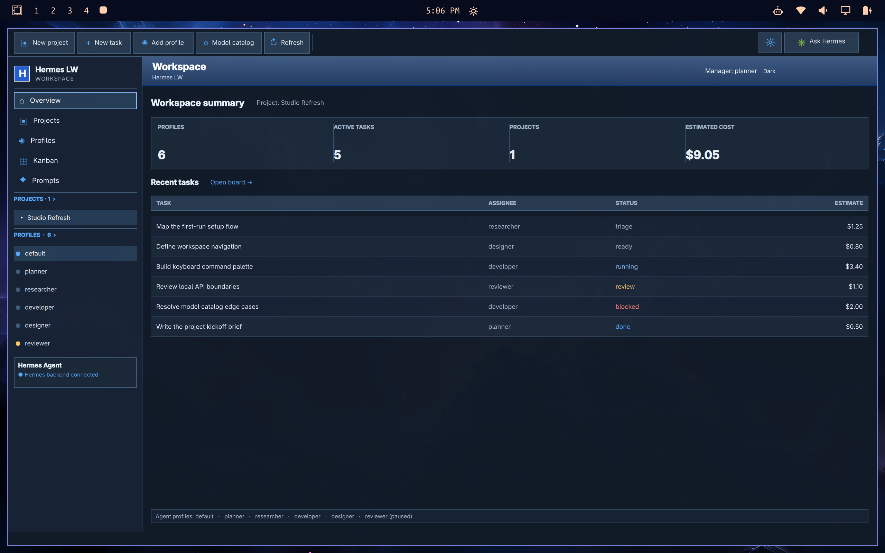
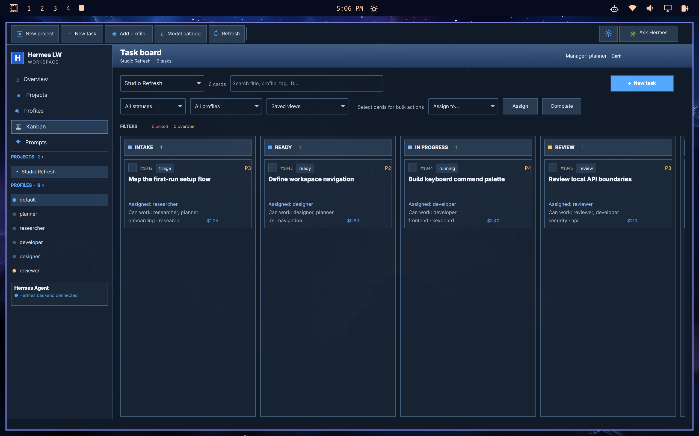
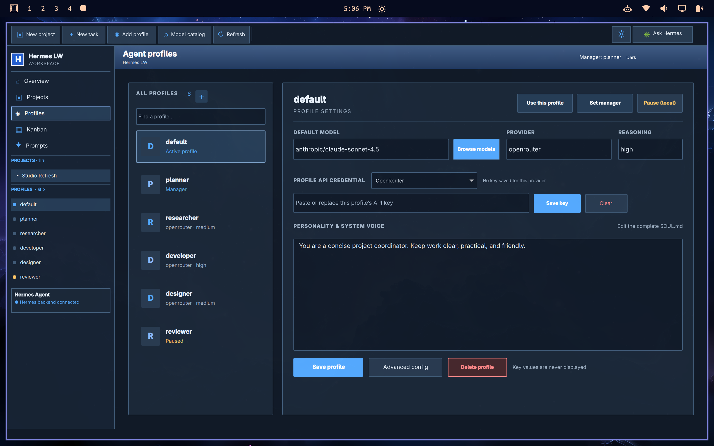
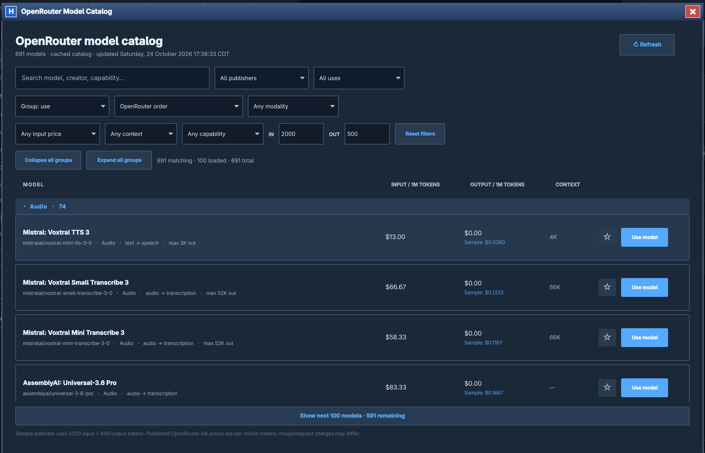

# Hermes LW

A native Quickshell prototype for controlling Hermes Agent profiles and the local Hermes Kanban board.

## Run

```bash
cd ~/Projects/hermes-control
./launch.sh
```

The prototype reads the installed Hermes profile files and current board through the `hermes` CLI. The always-visible **Options** toolbar button opens the Models & Providers page for each profile's backend, model, reasoning, and credentials. It supports full `SOUL.md` editing, an advanced JSON view of profile config, profile create/delete, config and full-state cloning, per-profile credentials for every inference provider registered by the installed Hermes version, a manager designation, pause/resume for new assignments, and name-based personality generation. API-key credentials are written to that profile's `.env` with owner-only permissions. Custom/local OpenAI-compatible endpoints have a per-profile base URL and key saved in the profile config with owner-only permissions. OAuth and system-auth providers use Hermes' own sign-in flow (`hermes model`). Secrets never return to the UI. The OpenRouter catalog has multi-term search, creator and use filters, modality/capability/price/context filters, grouping by use, creator, price, context, or modality, and sorting by popularity order, name, release date, price, or context. Its catalog controls are laid out in separate rows for smaller windows: **Collapse all groups**, **Expand all groups**, sample input/output token fields, per-model sample cost, and **Show next 100 models**. Other providers accept their provider-specific model ID. Catalog data refreshes from OpenRouter and is cached for six hours. A local prompt library supports reusable and favorite prompts.

Projects map to Hermes' isolated Kanban boards. The Projects page supports multiple boards, editable descriptions, owners, colors, budgets, deadlines, progress rollups, cost/effort totals, and JSON export to `~/Downloads`.

Ten workflow additions:

1. Set project budgets and see estimated spend and remaining budget.
2. Give each project an owner.
3. Set project delivery dates.
4. Track completion progress from Hermes task counts.
5. Add task tags and search by tag.
6. Set task due dates and see overdue dates highlighted.
7. Track planned effort hours beside cost estimates.
8. Start from built-in task templates or save custom templates.
9. Save board views with status, assignee, and search filters.
10. Select multiple tasks for bulk assignment, completion, or archiving.

Each task can limit work to selected profiles; the backend enforces that list for individual and bulk assignments. The board also supports scheduled work, task comments, dependency links, and per-project JSON exports while applying task lifecycle changes through Hermes' own CLI. Hermes owns the task body and comment history. The first config save makes a one-time `config.yaml.hermes-control-backup` next to the Hermes config. Pausing a profile in Hermes LW prevents new assignments from this app; already-running tasks continue. Cost estimates are stored by this app in `~/.local/share/hermes-control/estimates.json`; Hermes does not expose provider spend as Kanban task cost, so these are planning numbers rather than metered charges. The UI uses Windows XP Luna styling with a persistent dark mode.

The backend binds only to `127.0.0.1:18731` and rejects nonlocal hosts and cross-origin web requests. It needs Python 3 with PyYAML, Hermes Agent on `PATH`, and Quickshell. On Lua-configured Hyprland, the launcher applies a session-only rule to float, center, and size the desk for the current scaled monitor. It does not force a workspace or edit Hyprland config files.

The latest 25-item audit, GitHub references, and implemented fixes are documented in [AUDIT.md](AUDIT.md).

## Screenshots

These screenshots use fictional demo profiles, prompts, and tasks.








